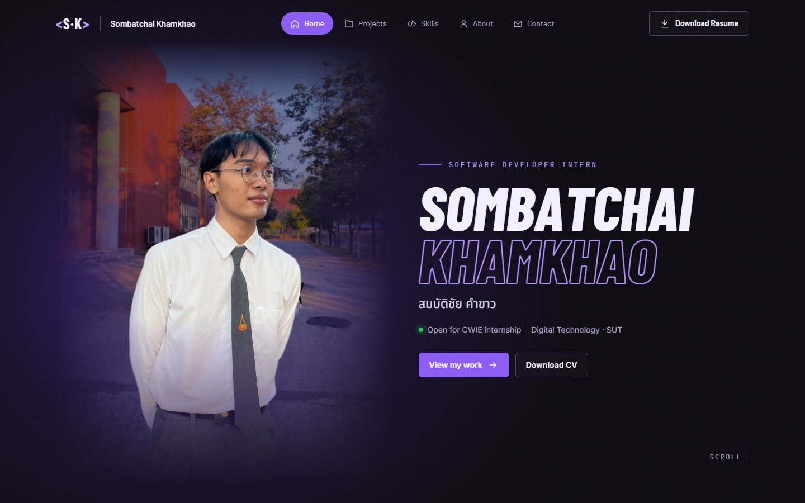
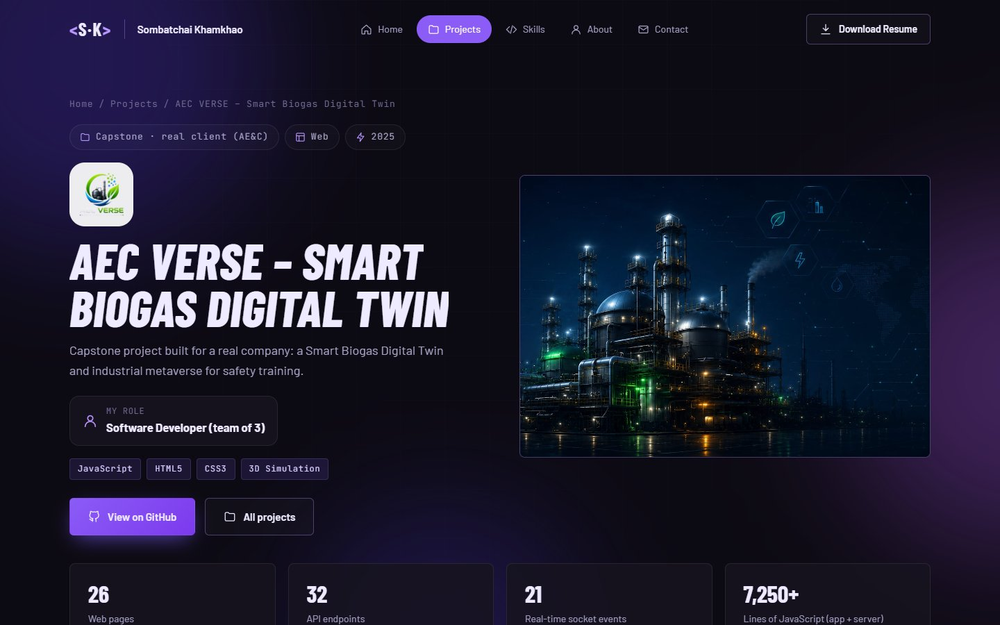

# Portfolio — สมบัติชัย คำขาว (Sombatchai Khamkhao)

เว็บไซต์ Portfolio ส่วนตัวของ **สมบัติชัย คำขาว** นักศึกษาชั้นปีที่ 3 สาขาเทคโนโลยีดิจิทัล มหาวิทยาลัยเทคโนโลยีสุรนารี (มทส.) ทำขึ้นเพื่อใช้สมัคร **ฝึกงานสหกิจศึกษา (CWIE) ตำแหน่ง Software Developer**

เว็บเล่าเรื่องแบบเลื่อนหน้าจอ (Scroll story) โปรเจคแต่ละตัวคือหนึ่ง "บท" พร้อมภาพหน้าจอจริง และกดเข้าไปอ่านรายละเอียดเชิงลึก (Case study) ของแต่ละโปรเจคได้

**🔗 ดูเว็บไซต์จริง: https://sombatchai.github.io/portfolio/**



## โปรเจคในเว็บไซต์

| โปรเจค | รายละเอียด | เทคโนโลยี |
| --- | --- | --- |
| **AEC VERSE** – Smart Biogas Digital Twin | โปรเจคจบที่พัฒนาให้บริษัทจริง: Digital Twin และ Metaverse ของโรงงานไบโอแก๊สสำหรับฝึกอบรมความปลอดภัย (26 หน้า, 32 API endpoints, Real-time socket) | JavaScript, Three.js, Node.js, Express, Socket.IO, Supabase |
| **MissionLife** – Gamified Habit Tracker | แอปมือถือที่เปลี่ยนเป้าหมายในชีวิตจริงให้เป็นเควส ได้ XP ถ้วยรางวัล และสู้บอส | React Native, Expo, Firebase, Figma |
| **Retail Insight** – Retail Sales Analytics | เว็บแอปให้ทีม Data Analytics: นำเข้าไฟล์ยอดขายแล้วดู Dashboard แนวโน้ม พยากรณ์ด้วย Linear Regression และสินค้าค้างสต๊อก · [▶ ลองเดโม](https://sombatchai.github.io/retail-insight/) | React 19, Vite, Tailwind CSS, Recharts, Firebase Firestore |
| **StockMB** – Inventory Management System | โปรแกรมเดสก์ท็อปจัดการสต๊อกและขายหน้าร้านสำหรับร้านค้าขนาดเล็ก พร้อมเอกสาร SRS ครบ | Electron, JavaScript, SQLite |
| **ChainPass** – Blockchain Ticketing (Hackathon) | ไอเดียและ Prototype จากการแข่งขัน Hackathon: ตั๋วบน Smart Contract, กระเป๋าเงินแบบ Escrow และขายต่อแบบล็อกเพดานราคา | Figma, แนวคิด Blockchain |
| **Wi-Fi Security Pentest** | ทดลองในห้องแล็บว่าความซับซ้อนของรหัสผ่านมีผลต่อความปลอดภัยของ WEP / WPA / WPA2 อย่างไร | Kali Linux, Aircrack-ng, Wifite, Wireshark |

ทุกโปรเจคมีหน้ารายละเอียดของตัวเอง ได้แก่ ภาพรวม เป้าหมายและบทบาทของผม ฟีเจอร์ ไดอะแกรม ภาพหน้าจอ เทคโนโลยีที่ใช้ และสิ่งที่ได้เรียนรู้



## จุดเด่นของเว็บไซต์

- **หน้าแรกแบบ Scroll story**: แอนิเมชันขยับตามการเลื่อนหน้าจอ (อัปเดตค่า CSS custom properties ทุกเฟรม) และเลื่อนแบบนุ่มนวลด้วย Lenis
- **แยกข้อมูลออกจากหน้าเว็บ**: เนื้อหาทุกหน้าสร้างจากไฟล์ข้อมูล JavaScript ธรรมดา อยากเพิ่มโปรเจคใหม่ก็แค่เพิ่มข้อมูลหนึ่งชุด
- **หน้า Case study สร้างอัตโนมัติ** จากข้อมูลชุดเดียวกัน: ตัวเลขสรุป, ไดอะแกรม Architecture และ Sequence แบบ SVG, แกลเลอรีภาพหน้าจอที่กดขยายได้, กรอบมือถือจำลอง
- **ไม่ใช้ Framework และไม่ต้อง Build**: เขียนด้วย HTML, CSS และ JavaScript ล้วน
- **รองรับทุกขนาดหน้าจอ**: มีเมนูสำหรับมือถือ และลดแอนิเมชันให้ผู้ที่ตั้งค่า Reduced motion ไว้

## เทคโนโลยีที่ใช้

- HTML5, CSS3 (Custom properties, Container queries, `clip-path`, Mask)
- JavaScript (ES2020+) แบบไม่ใช้ Framework
- [Lenis](https://github.com/darkroomengineering/lenis) สำหรับการเลื่อนหน้าจอแบบนุ่มนวล
- ฟอนต์จาก Google Fonts: Barlow, Barlow Condensed, Inter, JetBrains Mono, Noto Sans Thai
- โฮสต์บน GitHub Pages

## โครงสร้างโปรเจค

```
.
├── index.html             หน้าแรก (แนะนำตัว, ผลงาน, ทักษะ, เกี่ยวกับฉัน, ติดต่อ)
├── project.html           หน้ารายละเอียดโปรเจค (project.html?id=<รหัสโปรเจค>)
├── css/
│   ├── story.css          สไตล์และแอนิเมชันของหน้าแรก
│   ├── style.css          สไตล์พื้นฐานที่ใช้ร่วมกัน
│   ├── project.css        เลย์เอาต์หน้ารายละเอียดโปรเจค
│   └── theme-console.css  ธีมของหน้ารายละเอียดโปรเจค
├── js/
│   ├── data.js            ข้อมูลส่วนตัว ทักษะ และช่องทางติดต่อ
│   ├── projects.js        รายการโปรเจค (ชื่อ, แท็ก, บทบาท, ปี, ลิงก์)
│   ├── project-details.js เนื้อหาหน้ารายละเอียดของแต่ละโปรเจค
│   ├── story.js           สร้างหน้าแรกและระบบแอนิเมชันตามการเลื่อน
│   ├── main.js            ส่วนหัว ส่วนท้าย เอฟเฟกต์ และตัวขยายภาพที่ใช้ร่วมกัน
│   └── project-page.js    สร้างหน้ารายละเอียดโปรเจค
├── assets/img/            รูปภาพและภาพหน้าจอของโปรเจค
└── cv/                    ไฟล์ Resume (PDF)
```

## วิธีรันในเครื่อง

ใช้ Static file server ตัวไหนก็ได้ เช่น

```bash
npx http-server -p 5500 -c-1
```

แล้วเปิด http://localhost:5500

## วิธีแก้ไขเนื้อหา

- **ข้อมูลส่วนตัว ทักษะ ช่องทางติดต่อ**: แก้ที่ `js/data.js`
- **เพิ่มหรือแก้โปรเจค**: เพิ่มข้อมูลใน `js/projects.js` และเนื้อหาหน้ารายละเอียดใน `js/project-details.js` (ค่า `id` ต้องตรงกัน) แล้วใส่รูปไว้ที่ `assets/img/projects/<id>/`
- **Resume**: แทนที่ไฟล์ PDF ในโฟลเดอร์ `cv/` โดยใช้ชื่อไฟล์เดิม

## อัปเดตเว็บไซต์

แก้ไฟล์เสร็จแล้วรันคำสั่งด้านล่าง GitHub Pages จะอัปเดตเว็บให้เองภายใน 1–2 นาที

```bash
git add -A
git commit -m "อธิบายสั้น ๆ ว่าแก้อะไร"
git push
```

## หมายเหตุ

- ภาพหน้าจอและเดโมของ Retail Insight ใช้ข้อมูลตัวอย่างที่มากับ Repository ของโปรเจคนั้น ไม่ใช่ข้อมูลจริงของร้านค้า เดโมไม่เชื่อมต่อ Firebase ข้อมูลที่เพิ่มในเดโมจะอยู่แค่ในแท็บเบราว์เซอร์นั้นและหายเมื่อรีเฟรช
- ChainPass เป็นไอเดียและ Prototype สำหรับการแข่งขัน Hackathon ยังไม่ได้พัฒนาเป็นระบบที่ใช้งานจริง
- ข้อมูลส่วนตัวของบุคคลอื่นในภาพหน้าจอถูกเบลอแล้ว

## ติดต่อ

- อีเมล: schkkh0@gmail.com
- GitHub: [@sombatchai](https://github.com/sombatchai)

© 2026 สมบัติชัย คำขาว (Sombatchai Khamkhao) นำโค้ดไปศึกษาได้ แต่รูปภาพ ภาพหน้าจอ และ Resume เป็นของผม กรุณาอย่านำไปใช้ซ้ำ
